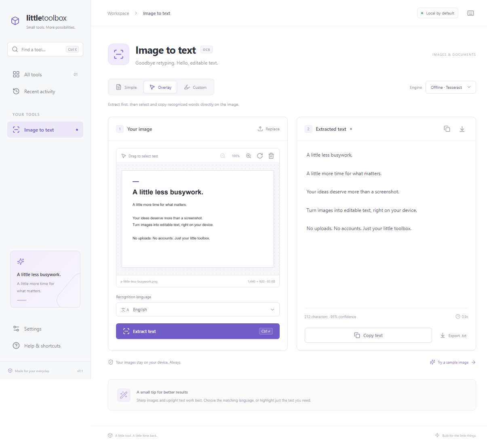

# Little Toolbox

A small desktop home for everyday utilities. The first tool extracts English and Chinese text from images, offline by default. Built with Tauri 2, React, TypeScript, and Tesseract.js.



## Use the app

On Windows, run the executable in `src-tauri/target/release/little-toolbox.exe`, or install the setup executable in `src-tauri/target/release/bundle/nsis/` after building.

1. Choose, drop, or paste an image. PNG, JPEG, WebP, BMP, and GIF are supported. GIFs are treated as a single image. Maximum input: 25 MB / 32 megapixels.
2. Select English, English + Traditional Chinese, English + Simplified Chinese, or all three.
3. Choose a mode and press **Extract text**.
   - **Simple:** read the entire image.
   - **Overlay:** read the image, then drag across recognized words on the image and copy your selection. Word positions are approximate. Uses the offline engine.
   - **Custom:** drag rectangular highlights over the areas to read. Add up to 12 regions; they are recognized in selection order. Undo removes the last highlight. Select all provides a keyboard-accessible whole-image region.
4. Edit the result, copy it, or export UTF-8 text. Images open at their actual pixel size. Use **Fit**, **100%**, or the 10–400% zoom selector, then scroll or use the hand tool to inspect the image. **Expand comparison** gives the image and text more space; press Escape or **Restore** to return. In Custom mode, select a numbered region to compare its image area with its editable extracted text.

Rotation turns the image clockwise and clears selections/results. The original file is never modified. Images larger than 3400 pixels on their longest side are downscaled for OCR; small images are upscaled. For difficult documents, crop to the text and choose **Scattered text** or **Single text block** in Settings. Printed text works best; handwriting, columns, tables, and unusual typography can require correction.

### Appearance and reading comfort

Open **Settings** to choose **Light**, **Dark**, or **System** appearance. System follows your device's appearance as it changes. **Font size** offers Small (100%), Medium (125%), Large (150%), and Extra large (175%), with an example that updates immediately. Medium is the default. These preferences apply throughout the toolbox and are saved locally; text sizing preserves the image's pixel scale and region coordinates.

### Optional online OCR

In Settings, enter an OpenAI-compatible **Chat Completions** API base URL (for example `https://api.openai.com/v1`), a vision model ID supported by your provider, and your own API key. Local providers can use `http://localhost:PORT/v1` without a key if supported. Then select **Online · Vision API** in the OCR tool.

The button changes to **Upload & extract text**. Simple mode sends the prepared image; Custom mode sends only the selected crops, one request per region. Provider fees and data policies apply. Image contents are treated as material to transcribe, with instructions to preserve the original language rather than translate. As with any vision model, check for omissions or invented text. Online responses do not provide reliable word geometry, so Overlay uses offline OCR.

The endpoint, model, and key live only in application memory and must be entered again after restarting. Credentials are never written to history or settings. Remote endpoints must use HTTPS; redirects are rejected by the native client. The native app makes requests through Rust to avoid browser CORS restrictions. Browser preview requires a provider that permits CORS. Cancellation aborts the app’s request, but a provider may already have started processing it.

### Privacy and local history

Offline OCR includes its worker, WebAssembly engines, and language models inside the app. No first-run downloads, external fonts, analytics, account, or OCR service are required. The operating system’s webview is a platform prerequisite; a Windows installer may install WebView2 if it is missing.

History stores the last 20 original OCR text results and filenames in local application storage; images and API credentials are never saved. Edits in the result editor are for the current session. Turn off **Keep recent activity** to clear saved history and stop saving results. Clearing history removes the app’s records from local storage; it does not remove exports you saved separately. Browser preview and the desktop app have separate local storage.

### Shortcuts

Use Ctrl on Windows/Linux and Command on macOS:

| Action | Shortcut |
| --- | --- |
| Open image | Ctrl/Command + O |
| Paste image | Ctrl/Command + V |
| Extract text | Ctrl/Command + Enter |
| Copy the entire result | Ctrl/Command + Shift + C |
| Find a tool | Ctrl/Command + K |

## Development

Use Node.js 22.12+ or 24 and npm. Native builds also require stable Rust and the [Tauri platform prerequisites](https://v2.tauri.app/start/prerequisites/): C++ build tools and WebView2 on Windows, Xcode command-line tools on macOS, and the documented WebKitGTK dependencies on Linux.

```sh
npm ci
npm run desktop
```

For a browser preview without Rust:

```sh
npm run dev
```

Open `http://127.0.0.1:1420`. Native clipboard and save dialogs are replaced with browser equivalents in preview. The desktop file-drop interception is disabled so standard image drop events reach the frontend.

```sh
npm run check                    # TypeScript + core tests
npm run check:native             # Rust tests (requires the native toolchain)
npm run test:e2e                 # Real OCR integration tests
npm run desktop:build            # Native packages for your current OS
npm run desktop:build -- --bundles nsis  # Windows setup executable only
```

Browser tests use installed Microsoft Edge on Windows. On macOS/Linux run `npx playwright install chromium` first. Chinese OCR tests require a CJK system font (such as Microsoft JhengHei or Noto Sans CJK).

`scripts/prepare-tools.mjs` runs each tool's optional asset-preparation hook. OCR's hook lives in `src/tools/ocr/scripts/prepare-assets.mjs` and copies its runtime and language data into `public/tools/ocr/` before development/build. Generated files are ignored by Git; production embeds them through `dist/`. Asset hashes and sizes are recorded in `tools/ocr/manifest.json`. A single OCR worker stays warm for repeated actions and releases its memory after 60 seconds of inactivity. See [third-party notices](THIRD_PARTY_NOTICES.md).

`scripts/desktop.mjs` uses a project-local Rust toolchain in `.tools/` when available, otherwise your system Rust installation. On Windows it also detects the standard Visual Studio 2022 C++ environment. It changes environment variables only for the child build process.

Cross-platform source and a manual CI workflow are included. Build each platform on that platform; macOS/Linux packages must be verified on their respective systems. Installers are unsigned until you configure your signing identities.

## Add another tool

Each tool lives under `src/tools/<id>/`, with its own manifest, UI, state, services, styles, build hook, and tests. Register its manifest in `src/tools/index.ts`. The core builds the tool navigation, library, search, settings, and activity pages from the registry. `src/App.tsx` only connects core to that registry.

The core owns the application layout and provides `ToolPage`, `SplitPane`, and `ToolPanel`. Tools fill named React slots and render their UI as a subtree of that layout. Read the [architecture and module guide](docs/architecture.md) for the layout tree, dependency rules, and a complete new-tool example. The initial release implements image OCR; macro recording/execution is a future tool.

Useful entry points:

- `src/core/`: generic toolbox shell, layout components, contracts, and shared platform services.
- `src/tools/ocr/`: the complete OCR frontend module; see its [module guide](src/tools/ocr/README.md).
- `src-tauri/src/tools/ocr/online.rs`: native OCR provider requests and cancellation.
- `src-tauri/src/platform/text_export.rs`: shared native text export.
- `src-tauri/capabilities/default.json`: minimal clipboard permissions.
- `src/core/tests/` and `src/tools/ocr/tests/`: core module-boundary tests and OCR integration tests.
